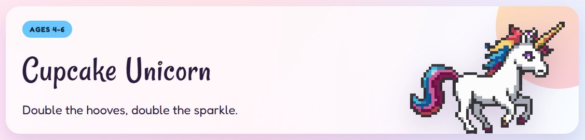
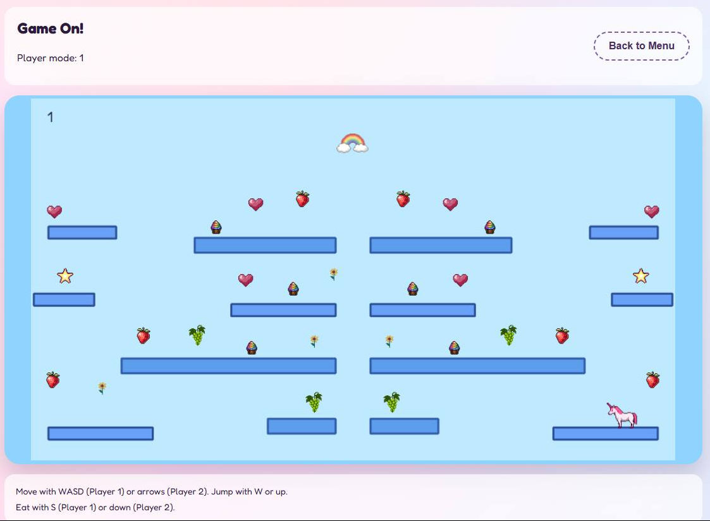

# CupcakeUnicorn

A playful unicorn mini-game built with Vue 3, TypeScript, and Vite.



## Origin

This project was directed by my six year old as part of her birthday celebration. Everything here was AI generated, including the code and assets.

## Open Source

This project is open source and free to use under the MIT license.



## Levels

The game rotates through eight levels forever, carrying each player's score along. Nobody ever loses; every level is about collecting as many sparkles as you can. Player 1 uses WASD and player 2 the arrow keys; `W` / `Up` is the "magic key" in every level, and tapping your side of the screen does the same thing.

1. **Cupcake Chase** - the platform level. Collect every pickup to finish the round.
2. **Pegasus Flight** - a side-scrolling flappy level. Flap and follow the trail of stars to the rainbow cloud. Two players get a split screen.
3. **Rainbow Garden Maze** - a top-down hedge maze, generated fresh each time. Pickups hide in the dead ends and the rainbow cloud in the middle is worth a bonus.
4. **Cupcake Catch** - one unicorn drops cupcakes from a cloud ledge, the other catches them below. Every catch scores for the whole team and the roles swap halfway. Solo players catch what the Rainbow Cloud drops.
5. **Tug of Rainbow** - tap your magic key fast to pull the star knot past your flag. Best of three, with a friendship bonus for everyone at the end. Solo players tug against the Rainbow Cloud.
6. **Mirror Dance** - the leader makes up a little dance on a 3x3 floor, then the follower copies it. Arrows show the steps, so it's about matching, not memory. The leader swaps every time the level comes around; solo players copy a ghost unicorn.
7. **Balloon Pop** - both unicorns get their wings back and share one sky. Fly into balloons to pop them (gold star balloons are worth three). Bumping into each other just bounces you apart.
8. **Fruit Dash** - an auto-running side level where the only control is jump. Run through fresh fruit for a point, jump over rotten fruit for a bonus. Touching rotten fruit only earns a "Yuck!" wobble and a moment of slow-down. Two players get stacked full-width lanes.

### Difficulty

Every full lap through the eight levels turns the difficulty up a notch, and the level banner says so ("Lap 2: a bit trickier!"). Platforms move more, the Pegasus path gets wilder, the maze has fewer shortcuts, cupcakes fall faster, the Rainbow Cloud tugs harder, dances get longer, balloons rise faster, and the fruit run speeds up with more rotten fruit. It stops climbing after the fifth lap so it never becomes unfair. The tier logic is `difficultyTier` in `src/game/levels.ts`.

The level order lives in `src/game/levels.ts`; shared helpers (banners, sparkles, keys, unicorn actors, scoring, level hand-off) are in `src/game/levelKit.ts`. Wings, clouds, balloons and other extra art are drawn procedurally, so no new image assets were needed.

Tip for testing: open the dev server with `?level=N` to jump straight to that level (`?level=14` is Mirror Dance on its second pass, with the other player leading).

## Pegasus Jump (bonus mode)

A separate, single-player endless climber: the Pegasus bounces on its own
forever and the only thing you control is left and right. Catch butterflies for
a bigger bounce and a chain bonus, land on clouds on the way down, and don't
fall off the bottom. There is no finish line, just a high score (kept in
`localStorage`).

It is a remake of **Kitten Jump** for iPhone/iPod, a game that has since
vanished. The only reference left is its trailer, so the jump arc, hang time,
climb rate and steering speed were measured off the video frame by frame and
rescaled to this game's screen - see [docs/skyjump-timing.md](docs/skyjump-timing.md)
for the measurements and how they were taken.

### How it flows

- **Clouds catch you two ways.** Falling onto the top of a cloud bounces you, as
  you would expect. Clipping a cloud's **underside** on the way *up* re-launches
  you on the spot and you carry straight on through it — so a good line chains
  bounce after bounce instead of waiting out each fall. Measured against a
  column of clouds, chaining undersides climbs at ~630 px/s against ~200 for
  plain bouncing. This is the single most important feel in the original.
- **Butterflies** bounce you in either direction and build a chain: each one in
  a row adds 7% lift up to +45%, and the chain lapses after 3.2 s without one.
- **Cupcakes** are rare and are a **Super Jump**: 2.1x the normal bounce, an apex
  of about a full screen, a rainbow trail, the wings out, and 25 points.
- **Chain float.** Chaining undersides buys height fast, and without a refund the
  cost is brutal: miss one and you drop from the top of a long climb at full
  gravity with nothing beneath you. So every link banks a little hang time (a
  cloud 0.35 s, a butterfly half that, up to 1.4 s), and while the bank lasts the
  top of each hop is softer and the fall is held near the camera's own descent
  speed. A missed line becomes a chance to steer rather than a plummet. It only
  ever touches the fall: an unchained hop still rises and lands on the measured
  0.98 s. Measured over a full chain, the time from a clean miss to falling off
  the bottom goes from 1.81 s to 2.49 s, and the first 400 px of the drop takes
  1.04 s instead of 0.68.
### Zones

The climb does not stay in the sky. Keep going and the air thins, then runs out,
and then you are somewhere else entirely. Each zone is a different game, not a
reskin: its own gravity, its own things to bounce off, its own thing to collect,
its own sky.

| Zone | Begins at | Gravity | You bounce off | You collect |
| --- | --- | --- | --- | --- |
| The Sky | 0 m | 1.00 | clouds | butterflies |
| The Atmosphere | 50,000 m | 0.86 | clouds, cirrus wisps | butterflies |
| Space | 10,000,000 m | 0.50 | asteroids, saucers, planets | stars |
| Unicorn Heaven | 1,000,000,000,000 m | 0.34 | haloed clouds | feathers |

**Why the numbers get silly.** Climb rate in pixels per second barely moves
between zones — for a bounce, apex is `v²/2g` and the period `2v/g`, so the rate
is `v/4` whatever gravity does. What changes is how much altitude a pixel is
*worth*: a metre over a field, then a metre of thinning air, then the distance
between rocks. `metresPerPx` goes 1/24, then 1.5, then 40,000, then a billion,
so the HUD leaves the thousands behind and never comes back, while the game in
front of you stays playable.

**Why those thresholds.** 50,000 m is where the air starts to thin because that
is the best run anyone has had — about 32 minutes of flawless climbing, reached
by one bot run in twelve. The best run so far is the *start* of the story. Past
that it is deliberately enormous: measured per zone, Space is about three and a
half hours in and Heaven about twelve and three-quarter hours in, on one run,
without dying. Heaven is meant to be a rumour. It is entirely possible nobody
will ever see it — half of all bot runs die inside four minutes of Space, so
surviving nine straight hours of it is not a thing that is going to happen by
accident. If it should ever need to be reachable, the only numbers to change are
the `fromMetre` and `metresPerPx` pairs in `ZONES`.

**The collection is the other reason to climb.** Butterflies, stars and feathers
are counted across every run you have ever played and shown when you fall, so a
run that ends at 2,000 m still added something that survives it. The high score
is not the only thing you take away.

- **One-use clouds** are an option, not the default — `CLOUD.vanishOnBounce`,
  the `V` key mid-run, or `?vanish=1`. A cloud puffs out as soon as you bounce
  off it, so the ladder burns away behind you. It plays as a different, much
  harder game rather than a harder setting: over 40 seeded bot runs the median
  climb falls from 5208 m to 331 m and every run dies inside 15 s, because the
  float cannot refund a ladder that is no longer there. Tightening the gap band
  to 95-140 brings the median back to ~1050 m if it is ever wanted as a hard
  mode.

### Art

Everything on screen sits on **one pixel grid**: `PIXEL` world px per art px, set
in `pixelArt.ts`. Mixed pixel sizes are the one thing that stops a screen reading
as a single piece of art, so the clouds, butterflies, cupcake and Pegasus all
share it. The grid is fine (2), not chunky, because the 2D game's sprites are
painted rather than pixel art.

- Clouds and butterflies are generated at that density (26-75 art px) with hard
  edges and a one-pixel outline — rasterised, not scaled-up vector shapes.
- The unicorn (56 px) and cupcake (32 px) are resampled to 50 and 30 and drawn at
  `PIXEL`, so they land on the same grid losing almost nothing.
- The wings are the exception, and deliberately so: they are the 2D game's own
  vector wing, rotated live exactly as the flight level does it. Resampling them
  onto the grid was tried first and lost the shape that makes a wing read as a
  wing. They are only on screen during a Super Jump, so the inconsistency is
  brief and reads as the cupcake's doing.
- Sprite positions are snapped to the grid, and bounce feedback is a whole-pixel
  shove rather than a scale tween, for the same reason.
- The Pegasus is never rotated either. Instead the frame is chosen from vertical
  velocity: the jump (attack) poses the other levels use, ordered rear-up,
  gather, level, reach, dive. The running loop was there first and read as
  galloping on the spot.

It runs in its own portrait (540x960) Phaser instance rather than joining the
level rotation, and splits in two:

- `src/game/skyjump/core.ts` - the whole simulation, pure TypeScript with no
  Phaser, no DOM and no timers. Seeded RNG, so a run can be replayed exactly.
- `src/game/skyjump/SkyJumpScene.ts` - the view. It owns no rules: each frame it
  steps the core and moves sprites to match.
- `src/game/skyjump/config.ts` - every tunable number, each traceable back to
  the trailer measurements. Change the feel here, not in the core.

Reach the mode from the "Pegasus Jump" card on the landing page, or open the dev
server with `?game=skyjump`. In dev the game instance is on
`window.__pegasusJump`.

Controls: hold Left/Right (or A/D), or click once on the canvas to take the
controls with the mouse — after that the Pegasus follows the pointer with no
button held, and how far away the pointer is sets how hard it steers, so you can
ease onto a cloud. Touching the keyboard hands the controls back to it. Space or
a click restarts after a fall. `V` toggles one-use clouds mid-run.

## Development

Install dependencies:

```bash
npm install
```

Run the dev server:

```bash
npm run dev
```

## Itch.io HTML5 Build

This project is configured to meet itch.io HTML5 ZIP requirements and common pitfalls:

- Relative paths are enforced in the build via `base: './'` in Vite.
- `index.html` remains the entry file at the ZIP root.
- File names are case-sensitive on itch.io, so keep references exact.
- Avoid absolute URLs or non-HTTPS external resources.
- Keep the final ZIP under itch.io limits (<= 1,000 files, 500MB total, 200MB per file, max 240-char paths).

```bash
npm run package:itch
```

That builds and writes `packages-out/cupcake-unicorn-itch.zip`, with `index.html`
at the ZIP root as itch requires, ready to upload as an HTML5 game. It refuses
to write a ZIP that would not upload cleanly, checking the four limits above
plus two things a Windows build can hide: filenames that differ only in case,
and characters some unzippers refuse. `--no-build` zips the existing `dist/`.

The ZIP is written by `scripts/zip.mjs`, a small deflate writer, so packaging
needs no dependency and the same `dist/` always produces byte-identical output —
a rebuild that changed nothing has the same sha256.
